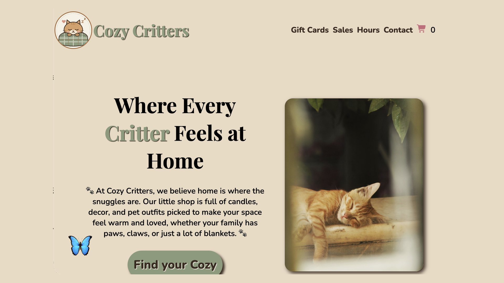

# Cozy Critters

**A cozy sample gift shop website, built to show local shop owners what their own website could do.**

**Live site:** [cozycritters.beautifulyouwebstudio.com](https://cozycritters.beautifulyouwebstudio.com)

---

## About

Cozy Critters is a made-up shop selling candles, home decor and pet outfits. I built it as a sample site for my web design business, **Beautiful You Web Studio**, to pitch small gift shops in Amador County that don't have a website yet.

Green 💡 sticky notes throughout the page explain to shop owners how each feature can help their business grow.

> This is a demo: no real payments are taken and no real emails are sent.

---

## Features

**Live e-gift card builder**
- Pick an occasion and the card's background picture and title change to match
- Choose a set price or type a custom amount
- "In your own words" opens a box to write a personal message
- To and From names appear on the card as you type
- A "Send" confirmation shows the shopper's email address

**Shopping**
- Cart counter in the nav that **remembers its number after a refresh** (localStorage)
- Wishlist buttons that toggle on and off
- Custom candle option that shows a message box when checked

**Responsive design**
- Layouts for big screens, laptops, tablets and phones (media queries)
- A **different hero photo for each screen size** using the `<picture>` element
- Tap-to-call phone number and a map for the shop's location

**Slide-in pitch for shop owners**
- Slides in 3 seconds after the page loads
- Remembers when it's been closed, so it doesn't nag (localStorage)
- Closes with a button or the Esc key
- A small butterfly tab brings it back any time

---

## Built With

- HTML
- CSS (Flexbox, Grid, media queries, transitions)
- JavaScript (DOM updates, event handling, localStorage, setTimeout)
- Hosted on GitHub Pages with a custom domain

---

## What I Learned

- Where code goes: why some variables and listeners live outside functions
- The difference between quotes (an exact word) and no quotes (a variable)
- Passing values into one reusable function instead of writing many
- Saving small bits of data in the browser with localStorage
- Serving different images to different screen sizes with `<picture>`
- Connecting a custom subdomain with DNS records

---

## Photo Credits

Hero photos by Melika Pourramezan, Ema Trinh and nadialovessingle on [Pexels](https://www.pexels.com).

---

## Author

**Christi Hansen** | Beautiful You Web Studio
[beautifulyouwebstudio.com](https://beautifulyouwebstudio.com) | [Portfolio](https://christihansen-png.github.io/eportfolio.christi/) | [GitHub](https://github.com/christihansen-png)
